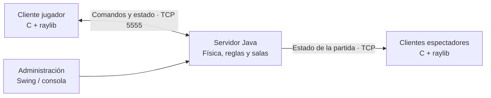

# Donkey Kong Jr. — C + Java

Juego de plataformas inspirado en **Donkey Kong Jr.**, desarrollado como proyecto académico de Paradigmas de Programación. Combina un **cliente gráfico en C con raylib** y un **servidor en Java** que ejecuta la simulación y sincroniza las partidas mediante sockets TCP.

El reto consiste en recorrer plataformas, trepar lianas, esquivar cocodrilos y recoger una llave para llegar hasta Donkey Kong. Además de jugar, es posible conectarse como espectador y seguir una partida en tiempo real.

## Características

- **Movimiento y física:** desplazamiento, saltos, gravedad, escalada y colisiones.
- **Enemigos con comportamientos distintos:** cocodrilos rojos que patrullan lianas y azules que caminan por plataformas y descienden por ellas.
- **Frutas coleccionables**, puntaje, vidas y dificultad progresiva. Cada victoria concede una vida adicional y aumenta la velocidad de los enemigos para la siguiente ronda.
- **Hasta dos jugadores conectados**, cada uno con su propia partida independiente.
- **Hasta dos espectadores por partida**, que reciben el estado del juego sin controlar al personaje.
- **Administración durante la partida** desde una ventana Swing o la consola del servidor para crear enemigos, agregar frutas y eliminarlas.
- **Herramientas de depuración visual** para inspeccionar las áreas de colisión.

## Cómo funciona



1. El cliente se conecta al servidor como jugador o espectador.
2. Cada jugador recibe una sala con su propio estado y un bucle de simulación que se ejecuta cada **16 ms**.
3. El cliente envía acciones de movimiento; el servidor actualiza posiciones, enemigos, colisiones, vidas y puntajes.
4. El servidor transmite los cambios al jugador y a los espectadores de su sala. Los clientes dibujan el escenario y las entidades con raylib.
5. El cliente comprueba la recogida de la llave y la llegada a la meta; al completar el objetivo, envía `WIN` y el servidor aplica la recompensa y reinicia la ronda con mayor dificultad.

La comunicación utiliza un protocolo de texto por líneas sobre TCP. Algunos comandos son `HELLO PLAYER`, `HELLO SPECTATOR 1`, `MOVE LEFT`, `MOVE JUMP`, `PING`, `WIN` y `BYE`. El servidor responde con mensajes como `OK`, `ACK`, `ERR` y `STATE`.

## Tecnologías y diseño

| Componente | Implementación |
| --- | --- |
| Cliente gráfico | C99 y raylib; ventana de 800 × 600 con objetivo de 60 FPS |
| Red del cliente | WinSock2 e hilo dedicado a la recepción de mensajes |
| Servidor | Java 17 o superior, sockets TCP y ejecución concurrente |
| Administración | Interfaz Swing y consola de comandos |
| Actualización del juego | `ScheduledExecutorService` y un bucle por sala |
| Eventos | Bus de eventos para difundir estado, puntajes, muertes y cambios de nivel |

El proyecto aplica orientación a objetos en el servidor y una organización por módulos y funciones en el cliente. La creación de enemigos y frutas se centraliza en `DefaultEntityFactory`, mientras que `GameEventBus` utiliza el patrón **Observer** para comunicar cambios sin acoplar la lógica del juego a las conexiones de red. El modelo también emplea interfaces `sealed` y objetos de valor para representar posiciones, identificadores, alturas y puntajes.

## Compilación y ejecución

Las instrucciones siguientes están orientadas a **Windows y PowerShell**, ya que el módulo de red del cliente utiliza WinSock2.

### Requisitos

- **JDK 17 o superior**, con `java`, `javac` y `jar` disponibles en el `PATH`.
- **GCC para Windows**, por ejemplo mediante MinGW-w64 o w64devkit.
- **raylib para ese compilador y arquitectura**, incluyendo `raylib.h` y la biblioteca compilada.
- Git para clonar el repositorio.

El repositorio incluye sprites y `raylib.dll` en `ClienteC/output/`, pero el cliente y el servidor deben compilarse desde el código fuente. La DLL por sí sola no incluye los encabezados ni la biblioteca necesarios para compilar el cliente.

### 1. Clonar el repositorio

```powershell
git clone https://github.com/jnzhng444/Tarea4Paradigmas.git
cd Tarea4Paradigmas
```

Ejecuta los siguientes comandos desde la raíz del repositorio.

### 2. Compilar e iniciar el servidor

```powershell
New-Item -ItemType Directory -Force -Path .\ServidorJava\build | Out-Null
$sources = @(Get-ChildItem .\ServidorJava\com -Recurse -Filter *.java | ForEach-Object { $_.FullName })
javac --release 17 -encoding UTF-8 -d .\ServidorJava\build $sources
java -cp .\ServidorJava\build com.dkj.main.ServerMain
```

El servidor escucha en el **puerto 5555** y abre la ventana de administración. Mantén este proceso en ejecución mientras utilizas los clientes.

También puedes generar el JAR que utiliza el lanzador incluido:

```powershell
jar --create --file .\ServidorJava\DKJServer.jar --main-class com.dkj.main.ServerMain -C .\ServidorJava\build .
.\ServidorJava\IniciarServidor.bat
```

Utiliza una sola de las dos formas de inicio a la vez, para evitar que ambos procesos intenten ocupar el mismo puerto.

### 3. Compilar e iniciar el cliente

En otra terminal, ajusta `$raylibDir` a la carpeta que contiene `raylib.h` y la biblioteca compilada de raylib:

```powershell
$raylibDir = "C:\raylib\raylib\src"
gcc -std=c99 -O2 ClienteC/raylib_client.c ClienteC/network.c ClienteC/level.c `
    -I "$raylibDir" -L "$raylibDir" `
    -o ClienteC/output/game.exe `
    -lraylib -lopengl32 -lgdi32 -lwinmm -lws2_32 -lm

.\ClienteC\output\game.exe
```

Conserva la carpeta `assets` junto al ejecutable para cargar los sprites. Si enlazas raylib de forma dinámica, utiliza una `raylib.dll` compatible con la biblioteca y la arquitectura con las que compilaste.

### 4. Jugar o mirar una partida

- Selecciona **PLAY** para iniciar una partida.
- Abre otra instancia del cliente y selecciona **OBSERVER** para observar a **Player 1** o **Player 2**, según los jugadores conectados.
- Puedes abrir una segunda partida con otro cliente, respetando el límite de dos jugadores activos.

Para conectar desde otro equipo de la red local, cambia `DKJ_SERVER_HOST` en [`ClienteC/constants.h`](ClienteC/constants.h) por la dirección IPv4 del equipo servidor y recompila el cliente. El puerto debe coincidir en ambos componentes; su valor se define en ese mismo archivo y en [`ServerMain.java`](ServidorJava/com/dkj/main/ServerMain.java). Permite conexiones TCP al puerto 5555 en el firewall del servidor cuando juegues por la red.

## Controles

| Acción | Control |
| --- | --- |
| Moverse a izquierda / derecha | `A` / `D` o flechas izquierda / derecha |
| Subir / bajar por las lianas | `W` / `S` o flechas arriba / abajo |
| Saltar | `Espacio` |
| Volver al menú y salir de la partida | `Esc` |
| Mostrar u ocultar la depuración visual | `F1` |
| Seleccionar opciones del menú | Clic izquierdo |
| Cerrar el cliente | Botón **EXIT** del menú o cierre de la ventana |

## Administración

La ventana del servidor permite consultar jugadores activos y enviar comandos a una partida usando su identificador. Estos son algunos ejemplos; reemplaza `<PLAYER_ID>` por el ID del jugador:

```text
ADMIN <PLAYER_ID> SPAWN CROCODILE RED 3 6
ADMIN <PLAYER_ID> SPAWN CROCODILE BLUE 2
ADMIN <PLAYER_ID> SPAWN FRUIT 2 8 100
ADMIN <PLAYER_ID> DELETE FRUIT 2 8
```

Los comandos anteriores crean un cocodrilo rojo, uno azul y una fruta de 100 puntos, y eliminan una fruta en la ubicación indicada. Las alturas se expresan en la escala lógica de **0 a 12** y el servidor valida las posiciones solicitadas.

## Estructura del repositorio

```text
Tarea4Paradigmas/
├── ClienteC/
│   ├── raylib_client.c       # Interfaz, entrada y representación del juego
│   ├── network.c / .h       # Comunicación TCP con WinSock2
│   ├── level.c              # Escenario, llave y detección de la meta
│   ├── constants.h          # Configuración de red y constantes
│   ├── types.h              # Tipos y estructuras del cliente
│   └── output/
│       ├── assets/          # Sprites del juego
│       └── raylib.dll
├── ServidorJava/
│   ├── com/dkj/
│   │   ├── main/            # Punto de entrada
│   │   ├── server/          # Conexiones, sesiones y salas
│   │   ├── game/            # Reglas, física y simulación
│   │   ├── entities/        # Jugador, enemigos y frutas
│   │   ├── model/           # Tipos del dominio
│   │   ├── commands/        # Interpretación de comandos
│   │   ├── events/          # Eventos y suscripciones
│   │   └── admin/           # Administración gráfica y por consola
│   └── IniciarServidor.bat  # Lanzador del JAR, una vez generado
├── docs/javadoc/            # Referencia del código Java
├── Makefile                 # Configuración de compilación del cliente
└── LICENSE
```

## Documentación

- [Manual de usuario](Manual_de_usuario4.pdf)
- [Documentación técnica](Documentacion%20Tecnica%20de%20Tarea%204.pdf)
- [Bitácora del proyecto](Bitacora_4.pdf)
- [Organización de paquetes del servidor](ServidorJava/ESTRUCTURA_PAQUETES.md)
- [Javadoc](docs/javadoc/index.html): abre el archivo localmente en un navegador para consultar la referencia del servidor.

## Licencia

El repositorio incluye una [licencia MIT](LICENSE). Proyecto académico inspirado en Donkey Kong Jr.
